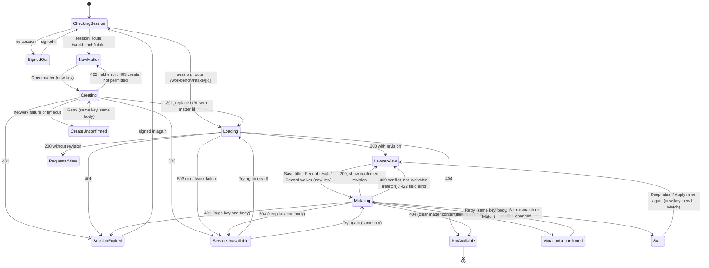
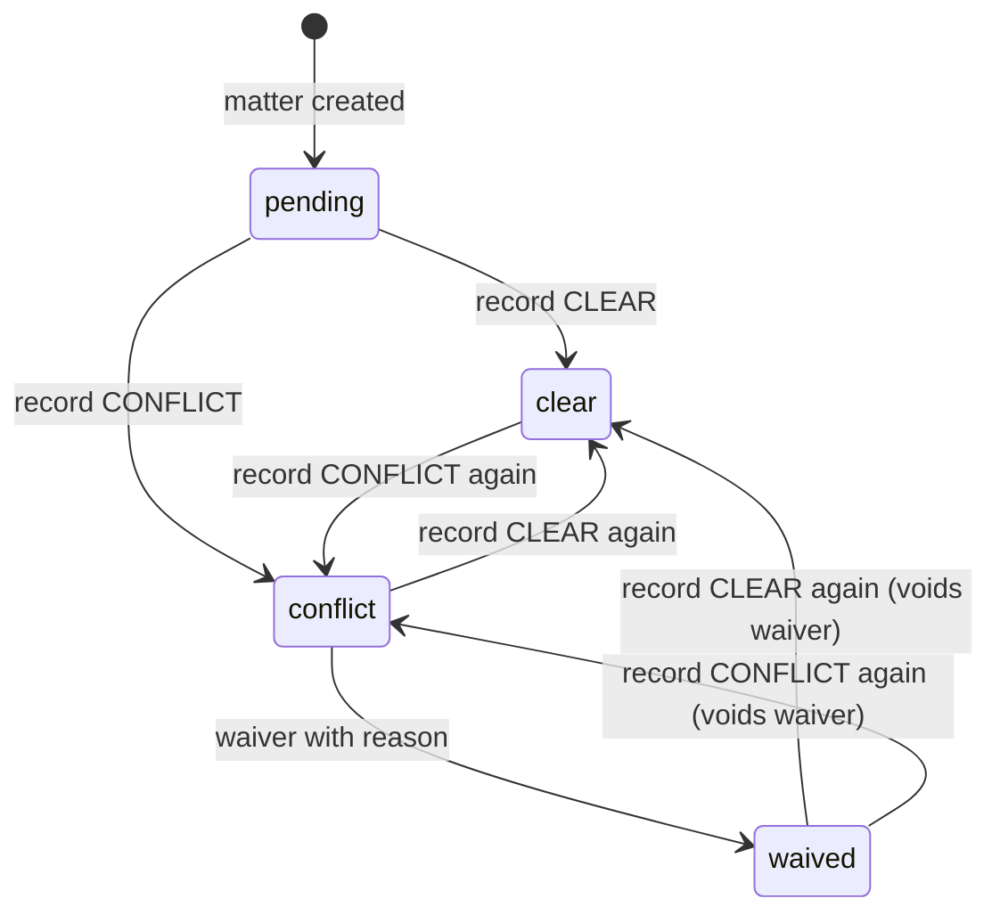

# Intake persistence: interaction and state specification

Status: design specification for build. Owner: designer. Build partner: engineer. Reviewers: security, QA, PDPA counsel.
Surface: the existing intake flow (`/workbench/intake`, `IntakePrototype`), wired to the authenticated matter API.
Contract: ADR 007 and `apps/api/src/verina/api/matters.py` on the draft branch `us-en15-authenticated-api` (PR #10, not merged at the time of writing). If the merged contract differs, the contract wins and this document is the bug.
Related: `docs/design/flows/US-1-US-3-intake-and-conflict.md` (prototype flow), `docs/design/DESIGN_SYSTEM.md` (tokens, stamps, motion, accessibility rules).

This document specifies behaviour, states and copy. It does not change the visual system. Every component, token, stamp and motion rule already in the intake prototype is kept; the work is to make each state truthful about what the server has and has not recorded.

## 0. Design read and pre-flight

Reading this as: an Operate surface (product UI, multi-step form with a recorded legal act) for associates, in-house counsel and business requesters, in the existing "filed document" language, leaning on native controls and the current CSS-variable system. Taste-skill section 13 places multi-step product UI outside its landing-page scope; its applicable checks (state completeness, form contrast, copy self-audit, motion motivation, reduced motion, zero em-dashes, no duplicate CTA intent) are applied below. Minimalist guidance informs restraint; redesign guidance applies as "preserve": no layout, token or component replacement.

Dials (stated, not defaulted): DESIGN_VARIANCE 3 (match existing single-column work surface), MOTION_INTENSITY 2 (state-change feedback only, at most 200 ms), VISUAL_DENSITY 5 (match existing).

## 1. Principles for persistence

1. **A recorded legal act is shown as recorded only after the server confirms it.** No optimistic display for anything that lands in the audit record: matter creation, title change, conflict result, waiver. The stamp, the progress line and the review gate change on a 2xx response, never on click.
2. **Unknown is a state, not an error.** When the network fails mid-request the outcome is unknown. The interface says so plainly and offers a retry that cannot create a duplicate (same `Idempotency-Key`, same body, same `If-Match`).
3. **Never silently overwrite.** A stale revision always shows the latest server state next to the user's unsaved input, and the user chooses. The client never re-sends with a refreshed `If-Match` on its own.
4. **One "not available" for everything.** Not found, other tenant, walled, not a member and role-denied on a matter all read identically, for every role, on read and on write.
5. **Show only what the server returned.** Lawyer and requester views are driven by the response projection, never by a client toggle or a cached earlier response. If the API does not return a fact (an actor name, a time, a reason), the interface does not invent or reconstruct it.
6. **Unsaved input stays in page memory only.** Matter content, waiver reasons and idempotency keys are never written to `localStorage`, `sessionStorage`, IndexedDB, cookies or the URL.

## 2. Modes and routes

| Mode | When | Route | Data | Disclosure |
| --- | --- | --- | --- | --- |
| **Preview** | Public deployment, or `VERINA_MATTERS_API_ENABLED` off | `/workbench/intake` (unchanged) | In-memory synthetic fixtures, view switch, sample prefill | Existing synthetic-prototype notice and footer, unchanged |
| **Connected** | Signed-in deployment with the matter API enabled | `/workbench/intake` (new matter) and `/workbench/intake/[matterId]` (resume) | `/v1/matters` only | Development notice (section 9) until PO and counsel record that real matter data may be entered |

Mode is a deployment setting, not a user control. The public preview never calls the API, never shows a sign-in prompt and keeps its current copy word for word: "Synthetic prototype. Use invented examples only. Demo entries stay in this page's memory and reset on reload; nothing is uploaded or sent by this walkthrough." and the footer "All matters, parties and people on this page are synthetic."

Connected mode removes three preview-only elements: the "View as" switch (role comes from the server), the sample prefill (fields start empty, so test records are deliberate), and the "Start again" reset (a created matter cannot be un-created; see "Open another matter" in section 6.3).

URL rules: the matter id is the only matter data in the URL. Titles, statuses, tokens and keys never appear in a path, query string or fragment. After a successful create the client replaces (not pushes) the history entry with `/workbench/intake/<matter_id>`, so Back does not return to a filled create form.

## 3. What the contract supports, and what that means for the existing flow

The prototype collects more than the API stores. Connected mode must not present unsaved fields as part of a saved matter.

| Prototype element | API support today | Connected behaviour |
| --- | --- | --- |
| Counterparty, contract type, value, needed-by date, document | Not stored (create and update accept `title` only) | Not rendered in connected mode. Replaced by one required field, **Matter title**. Each returns when the API stores it (open question Q1). |
| Matter title | `POST /v1/matters {title}`, `PATCH {title}`; 1 to 200 characters, not blank, no control characters | New first field; editable after creation by lawyers |
| Matter reference `VR-2026-0147` | `matter_id` | Shown as "Reference" in tabular figures; full id, selectable, wraps at any character |
| Preset register matches | No register search over HTTP | Panel replaced by a one-line note (section 10, C-14). No fixtures in connected mode. |
| Results: Clear, Conflict found | `POST .../conflict-checks {result: CLEAR or CONFLICT}` | Offered while status is `pending`; also offered as "Change the result" afterwards, because the API allows re-recording (it replaces the check and voids any waiver) |
| Result: Conflict waived from pending | Refused (`409 conflict_not_waivable` without a recorded check) | Waiver offered only when `conflict_status` is `conflict` |
| Decline the matter | No endpoint | Not offered in connected mode (open question Q2) |
| Waiver reason | Accepted, never returned or echoed | After confirmation the reason text is cleared from the page and never shown again from the client (section 6.6) |
| Stamp imprint "Nadia Lim, 13 Oct 2026, 14:20 SGT" | No actor name or time in any response | Imprint reads "On record, revision N" until attribution is returned (exception E-1, open question Q3). No name or time is invented. |
| "Recorded as Nadia Lim, associate" | No profile endpoint | "Recorded under your signed-in account." (open question Q4) |
| Requester status, lawyer name, target date | Requester projection is `{matter_id, status}` only | Requester sees reference and status only |
| Requester submitting intake | Create is lawyer-only (`403 forbidden` for others) | See section 7.2 |

## 4. State model

### 4.1 Page lifecycle

`RequesterView` has no mutations. It refreshes by `GET` only (section 7.2).

### 4.2 Conflict status as returned by the API (lawyer projection)

`status` is `ready` for `clear` and `waived` (when the server judges the record valid) and `awaiting_clearance` otherwise. The review gate renders from `status`, not from `conflict_status`. If they disagree (for example `waived` with `awaiting_clearance`), the gate stays closed and the stamp still shows the server's `conflict_status`; the server is the authority.

### 4.3 Mutation lifecycle and the Idempotency-Key

A request is the tuple (method, path, body, `If-Match`). One `Idempotency-Key` (a fresh `crypto.randomUUID()`) belongs to exactly one request tuple.

| Event | Key | Body and `If-Match` | Inputs |
| --- | --- | --- | --- |
| User commits the action (button activation after client validation passes) | Generate | Freeze from current inputs and the last confirmed revision | Read-only (`readonly`, not `disabled`, so they stay focusable and readable) |
| Network failure, timeout, 503, 401 | Keep | Keep frozen | Stay read-only |
| Retry, including after signing in again | Reuse | Re-send identical | Read-only |
| 2xx | Discard | Adopt returned `revision` | Editable, cleared or updated |
| 404, 409 (any code), 422, 400, 413, 415, 428, 500 | Discard | Discard frozen copy; keep the user's visible input where section 6 says so | Editable |
| User leaves the page with a pending or unconfirmed request | Lost | Lost | Warn first (section 6.9) |

Automatic retry: at most two silent retries for network failure only (not for any HTTP status), after 1 s and then 3 s, during which the "Saving" state continues. After that the state becomes Unconfirmed and the user decides. Request timeout: 15 s per attempt (engineer may tune; record the value).

Double activation: while a request is in flight the action button carries `aria-disabled="true"` and ignores further activation. It stays focusable so focus is never lost.

`409 idempotency_key_reused` should be unreachable because the body is frozen. If it occurs, treat it as a client defect: discard the key, refetch (for a matter route), show C-33, and log the code (no content) for engineering.

## 5. Signed-out, session and identity

The identity provider is not chosen (Supabase is pending; ADR 007 is provider-neutral). This section defines the auth surface abstractly. Real sign-in UI is designed once the provider is chosen and its session-storage behaviour is reviewed by security.

### 5.1 Auth surface contract (what the intake needs from any provider)

- `getSession()`: signed in or not, without a network round trip where possible.
- `getAccessToken()`: a current bearer token for `Authorization: Bearer`. Tokens are never placed in URLs, logs or analytics.
- `signIn({ returnTo })`: starts sign-in. `returnTo` is a same-origin path from an allowlist (the current intake route), never an absolute URL from input.
- `reauthenticate()`: signs the same person back in after expiry. Preferred mechanism keeps the page alive (silent renewal or a separate window), so in-memory input and pending keys survive. If the chosen provider can only do a full-page redirect, unsaved input and pending keys are lost, and copy C-08 must say so before the user leaves.
- `onIdentityChange(callback)`: fires on sign-out or when a different subject signs in.

### 5.2 States

| State | Trigger | Surface |
| --- | --- | --- |
| Signed out | No session on a connected route | The intake panel is replaced by a sign-in panel (C-01, C-02). No matter request is sent. |
| Session expired | Any `401` | Inline alert above the active panel (C-05 to C-08). Inputs and any pending key are kept. The matter content already on screen stays visible but read-only until sign-in completes, then the page refetches. |
| Identity changed | `onIdentityChange` with a different subject, or sign-out | Purge every in-memory matter field, revision, key and input immediately, then route to Checking session. Never show one account's data under another account. |
| Account not set up | `401` immediately after a fresh sign-in (unknown binding or inactive principal; the API does not distinguish) | C-09. Same copy for both causes. |

Revocation is server-side (ADR 007): a deactivated principal's in-flight mutation rolls back and returns `401`. The interface treats it exactly like expiry.

## 6. Lawyer states (connected)

### 6.1 New matter (draft, nothing saved)

The existing `IntakeForm` layout: `New matter` panel plus the `What happens next` aside. One required field, Matter title, label above, hint below the label, error below the input. Client validation mirrors the server exactly: trimmed value not blank; at most 200 Unicode code points after trimming (count with `Array.from`); no control characters (code points below 32 and 127). The client sends the trimmed value. The counter appears only within 20 characters of the limit (C-12).

Primary action: "Open matter" (replaces "Submit for conflict check", because creating the matter is the act; the conflict check is the next step). One primary action only.

### 6.2 Creating and saving (pending confirmation)

- Button label changes to "Opening matter" (create) or "Saving" (title) or "Recording" (conflict result, waiver). `aria-disabled="true"`. The panel region gets `aria-busy="true"`.
- No spinner and no shimmer. A static text state is calmer and identical under reduced motion.
- The polite live region announces C-20 only if the request is still pending after 500 ms, so fast saves are not chatty.
- The stamp, progress line and gate do not change.

### 6.3 Saved, with revision

- Create (201): replace URL, `GET` the matter, render the lawyer view. Focus moves to the matter heading (the reference `h2`, `tabIndex=-1`). Announce C-21.
- Title saved (200): the field returns to read mode showing the new title; a quiet meta line under the title reads C-22. Focus returns to the "Edit title" button. Announce C-22.
- Conflict result or waiver recorded (200): the stamp, gate and progress line update together from the response, then the existing 200 ms stamp settle runs (motion-OK only). Focus moves to the "Conflict check" heading (existing behaviour). Announce C-23 / C-24 / C-25.
- The meta line "Saved. Revision N." is the persistent confirmation. It is plain text, not a toast, so it does not time out.
- "Open another matter" (quiet link button in the toolbar, where "Start again" sat) navigates to `/workbench/intake` with an empty form.

### 6.4 Unconfirmed after network loss

An inline alert in the panel that owns the action (`role="alert"` container, heading `h3`, focus moved to the heading). Copy C-30 to C-32. One action: "Retry" (primary), which re-sends the same key, body and `If-Match`. Retry is also the confirmation check: if the first attempt was committed, the server replays its stored receipt and the page shows the saved state; if it was not, the request is applied now. The client does not try to infer the outcome from a `GET`, because a revision bump by someone else would look the same. For create there is no lookup by key either (open question Q5).

Inputs stay read-only. Leaving the page is guarded (section 6.9).

### 6.5 Stale edit (`409 revision_mismatch`) and conflict changed (`409 conflict_changed`)

Sequence: discard the key, `GET` the matter, then render a comparison inside the panel that owns the action. Focus moves to the comparison heading. Never auto-resubmit.

Title edit:

| Region | Content |
| --- | --- |
| Heading | C-40 |
| Latest saved | Label "Latest saved title (revision N)" and the server title, read-only |
| Yours | Label "Your unsaved title" and the user's input, still editable |
| Actions | "Keep the latest" (discards yours; focus to "Edit title") and "Save my title" (new key, `If-Match` = latest revision; a deliberate second save) |

Conflict result or waiver: the stamp and gate re-render from the latest response first, so the user sees what is now on record. Then:

- If the user's intended action is still available on the latest state (for example they chose Clear and the latest is still `pending` after a title change by someone else), keep their selection and reason, show C-41, and require them to press "Record result" again.
- If it is no longer available (for example they were waiving and the latest is `clear`), show C-42 and keep any waiver reason they typed in a read-only block with a "Copy reason" button, so their words are not lost. The reason is cleared when they leave or dismiss.

The changed stamp is marked with persistent text "Changed since you opened this matter" beside it. Colour and motion are not the cue.

Background change detection: when the window regains focus after 60 s or more, the client refetches if no request is pending. If nothing is being edited, the page updates in place and announces C-43. If the user is editing, the page does not replace their input; it shows a non-blocking notice C-44 with "Show latest", which opens the same comparison.

### 6.6 Waiver reason handling

- Client validation mirrors the server: trimmed value not blank; at most 2,000 code points; no control characters other than newline and tab. The client sends the trimmed value. No minimum length, and no assessment of whether the reason is legally sufficient.
- During Recording and Unconfirmed the textarea is read-only, not cleared.
- On 200 the textarea and its value are cleared from the page. The confirmed view says the waiver and its reason are on record (C-25) and does not display the reason, because the API never returns it: showing it now but not after reload would make the page inconsistent.
- The reason is never sent to analytics, logs, the URL or storage.

### 6.7 Not found or no access (`404`, read or write)

One component, one copy (C-50, C-51), identical for lawyers and requesters, for a missing matter, another tenant's matter, a walled matter, a non-member and a role denial, and whether the 404 came from `GET` or from a mutation.

On a 404 after a matter was already displayed (for example membership removed mid-session), clear every matter field, revision, key and unsaved input from memory and the DOM before rendering the panel. Focus moves to the panel heading. The document title becomes "Matter not available | Verina". No link back to the matter is offered; "Go to Intake" opens a new matter form (lawyers) and the same link is shown to requesters, who will then meet section 7.2.

Timing and size: the client must not reveal a difference either. Do not show a different skeleton duration, retry count or message for 404 depending on any earlier knowledge of the matter.

### 6.8 Service unavailable (`503`) and other failures

- `503` on read: C-60 with "Try again". Matter content previously displayed stays visible with a "Last loaded" marker (C-62); actions are paused (aria-disabled with the reason linked by `aria-describedby`).
- `503` on a mutation: C-61. Key and body kept; "Try again" re-sends identically. Copy does not claim nothing was saved; the contract fails closed, but the client treats the outcome as unknown and relies on the idempotency key.
- `500 internal_error`, `400`, `413`, `415`, `428`: client or server defects, not user errors. C-63, key discarded, inputs editable, the error code logged without content.
- `422 validation_failed`: attributed to the single field the request carried (title or waiver reason), copy C-13 or C-16. The client should have caught it; the server message is generic, so the copy says what the rules are.
- `403 forbidden` (create only): C-10, form stays, no retry.

### 6.9 Reload, resume and leaving the page

| Situation | Behaviour |
| --- | --- |
| Reload or open `/workbench/intake/<id>` | Checking session, then Loading (skeleton matching the summary and conflict panels, static, no shimmer), then the view for whatever stage the server returns. The user resumes at that stage: `pending` shows Record result; `conflict` shows the waiver option and Change the result; `clear` and `waived` show the gate open. |
| Reload of `/workbench/intake` before Open matter | Nothing was saved; the empty form returns. A typed title is lost; the leave guard warns first. |
| Leave or reload with unsaved input, or a request pending or unconfirmed | Native `beforeunload` prompt (the browser controls its wording). In-app navigation uses a confirm step with C-70 and buttons "Stay on this page" (default focus) and "Leave without saving". |
| Unconfirmed create, user leaves anyway | The matter may or may not exist. Nothing can be recovered client-side. This is the residual risk behind Q5. |

## 7. Requester view (connected)

### 7.1 Status page

Rendered when `GET` returns no `revision` (requester projection). The client never requests or holds the lawyer projection for this session.

| Element | Content |
| --- | --- |
| Heading | "Request status" (the requester projection has no title) |
| Reference | `matter_id`, labelled "Reference" |
| Status | `awaiting_clearance`: C-80. `ready`: C-81. |
| Foot | C-82 |

Not shown: title, revision, conflict status, stamp, register note, waiver, gate wording, progress line, lawyer name, target date, any action. None of these exist in the response, and none may be filled from elsewhere (no cache, no earlier lawyer session in the same tab, see section 5.2).

Refresh: a quiet "Refresh status" button (`GET`), result announced politely (C-83). No polling.

### 7.2 Requester on the new-matter route

The API only lets lawyers create. Until the client can learn the role before rendering (open question Q6), the form renders for any signed-in user and a `403` returns C-10. The form must not hint at which roles exist or why access is refused.

## 8. Accessibility (WCAG 2.2 AA)

Focus management (one target per transition, set after the new region renders, using the existing `focusAfterRender` pattern):

| Transition | Focus moves to |
| --- | --- |
| Client validation fails | First invalid field |
| Create confirmed | Matter reference heading |
| Title saved | "Edit title" button |
| Conflict result or waiver confirmed | "Conflict check" heading (existing) |
| Unconfirmed, session expired, unavailable on mutation | The alert's heading (`h3`, `tabIndex=-1`) |
| Stale comparison | The comparison heading |
| Not available | The panel heading |
| Sign-in panel | Its heading on route entry; the Sign in button is next in order |
| Dismiss or resolve an alert | The control that started the action |

Announcements: keep the single existing polite live region for progress and success (C-20 to C-25, C-43, C-83). Blocking problems render inside a `role="alert"` container placed in the panel that owns the action, so the message is read once and is also present for anyone who navigates there later. Do not announce the same message in both regions.

Error association: every field error has an id referenced by the field's `aria-describedby` alongside its hint, and the field carries `aria-invalid="true"`. Server-originated field errors (422) use the same mechanism. Alerts that explain why an action is paused are referenced by that action's `aria-describedby`.

Read-only during save: use `readonly` on inputs and `aria-disabled` on buttons, never `disabled`, so nothing drops out of the tab order and screen-reader users can still read what is being sent.

Status without colour: stamps keep text, icon shape and colour. "Saved. Revision N.", "Changed since you opened this matter" and "Last loaded" are text. Nothing relies on a tint or an animation.

Targets: existing sizes (buttons at least 40 px, nav 44 px). New buttons follow the same classes.

Document title: reflects state for tab and screen-reader context: "New matter | Verina", "Matter <reference> | Verina", "Request status | Verina", "Matter not available | Verina", "Sign in | Verina". Titles never include the matter title.

Timeouts: the session timeout is set by the provider. If the provider exposes expiry ahead of time, warn at least 2 minutes before with an option to extend (2.2.1 Timing Adjustable); otherwise the 401 path preserves input so no data is lost to a timeout inside the page.

## 9. Motion and the development notice

Motion: only the existing 200 ms stamp settle, triggered by a confirmed status change (not by Saving, not by a refetch that returns the same status). Under `prefers-reduced-motion: reduce` it does not run; the stamp is fully visible at rest by default. No new motion is added for alerts, saving or comparisons. Lenis remains the single smooth-scroll instance; alerts are in normal flow, so moving focus to them scrolls natively and respects the header offset.

Development notice (connected mode, until PO and counsel record otherwise), in the existing `synthetic` style with the Flask icon: C-90. It sits in the page intro in place of the preview disclosure. The public preview keeps its own notice unchanged.

## 10. Microcopy

Plain, sentence case, no exclamation marks, no em or en dashes, no legal advice. "You" is the signed-in person; "Verina" is the system. Placeholders in angle brackets are filled from the response.

| Id | State | Where | Copy |
| --- | --- | --- | --- |
| C-01 | Signed out | Panel heading | Sign in to continue |
| C-02 | Signed out | Panel body, button | Sign in to open a matter or view its status. Button: "Sign in" |
| C-05 | Session expired | Alert heading | Your session has ended |
| C-06 | Session expired, nothing pending | Alert body | Sign in again to keep working. Your unsaved changes stay on this page. Button: "Sign in again" |
| C-07 | Session expired, request pending | Alert body | Sign in again to finish saving. Your last change has not been confirmed. After you sign in, Verina sends the same request again, so it cannot be recorded twice. Button: "Sign in again" |
| C-08 | Session expired, provider needs full redirect | Appended to C-06 or C-07 | Signing in reloads this page. Changes that are not saved will be lost. |
| C-09 | Account not set up | Panel | Heading: "Your account is not set up for Verina". Body: "You signed in, but this account cannot use Verina yet. Contact your Verina administrator." |
| C-10 | 403 on create | Form-level error | Your account cannot open matters. A lawyer on your team can open one for you. |
| C-11 | Title field | Label, hint | Label: "Matter title (required)". Hint: "A short working name, such as the counterparty and contract type." |
| C-12 | Title near limit | Below field | <n> characters left |
| C-13 | Title invalid | Field error | Blank: "Enter a matter title." Too long: "Keep the title to 200 characters or fewer." Control characters: "Remove line breaks and hidden characters from the title." |
| C-14 | Register note | Conflict panel, replaces preset matches | Verina does not search a conflict register in this release. Record the result of your firm's check here. |
| C-15 | Recorded-as line | Under Record result | Recorded under your signed-in account. |
| C-16 | Waiver reason | Label, hint, errors | Label: "Reason for waiver (required)". Hint: "Up to 2,000 characters. The reason is kept in the matter's audit record and is not shown on this page after it is saved." Blank: "Enter a reason for the waiver." Too long: "Keep the reason to 2,000 characters or fewer." Control characters: "Remove hidden characters from the reason." |
| C-17 | Waiver unavailable from pending | Option help (only if shown as context) | A waiver can be recorded after a conflict is recorded. |
| C-18 | Change result option | Option help | Replaces the current result. Any waiver on record stops applying. |
| C-20 | Saving (after 500 ms) | Live region | Saving. |
| C-21 | Create confirmed | Live region; meta line | Matter opened. Reference <id>. Revision <n>. Conflict check pending. |
| C-22 | Title confirmed | Meta line and live region | Saved. Revision <n>. |
| C-23 | Clear confirmed | Live region | Conflict check recorded as clear. Revision <n>. Ready for review. |
| C-24 | Conflict confirmed | Live region | Conflict recorded. Revision <n>. Review stays blocked until the conflict is waived with a reason. |
| C-25 | Waiver confirmed | Live region; panel note | Waiver recorded with its reason. Revision <n>. Ready for review. The reason is in the audit record. |
| C-26 | Stamp imprint (interim, E-1) | Stamp detail | On record, revision <n> |
| C-27 | Gate | Gate line | Open: "Ready for review. A conflict result is on record." Closed, pending: "Review is blocked until a conflict result is recorded." Closed, conflict: "Review is blocked until the conflict is waived with a reason." |
| C-30 | Unconfirmed | Alert heading | Not confirmed yet |
| C-31 | Unconfirmed, create | Alert body | Verina could not confirm the matter was opened. Your connection may have dropped. Retry sends the same request, so it cannot open a second matter. Button: "Retry" |
| C-32 | Unconfirmed, change to a matter | Alert body | Verina could not confirm this change was saved. Retry sends the same request, so it cannot be recorded twice. Button: "Retry" |
| C-33 | Key reused (defect) | Alert | Heading: "This request could not be completed". Body: "Verina has reloaded the latest version of this matter. Check it, then try again." |
| C-40 | Stale title | Comparison heading and body | Heading: "This matter changed while you were editing". Body: "Someone saved a new version (revision <n>). Your title has not been saved. Choose which to keep." Buttons: "Keep the latest", "Save my title" |
| C-41 | Stale, action still possible | Panel alert | Heading: "This matter changed before your result was recorded". Body: "The latest version is shown above. Your choice is still selected but has not been recorded. Check it, then select Record result again." |
| C-42 | Stale, action no longer possible | Panel alert | Heading: "The conflict check changed before your result was recorded". Body: "It now reads <stamp label>. Your result was not recorded. Your waiver reason is kept below until you leave this page." Button: "Copy reason" (only when a reason exists) |
| C-43 | Background refresh applied | Live region | This matter was updated. Now at revision <n>. |
| C-44 | Background change while editing | Notice | This matter has changed since you opened it. Your edits are kept. Button: "Show latest" |
| C-45 | Changed marker | Beside the stamp | Changed since you opened this matter |
| C-50 | Not available | Panel heading | This matter is not available |
| C-51 | Not available | Panel body, link | It may not exist, or your account may not have access to it. Check the link, or ask the person who shared it. Link: "Go to Intake" |
| C-60 | Unavailable on read | Alert | Heading: "Verina cannot load this matter right now". Body: "This is a problem on our side. Try again in a few minutes." Button: "Try again" |
| C-61 | Unavailable on save | Alert | Heading: "Verina could not save this just now". Body: "Try again in a few minutes. Retrying sends the same request, so it cannot be recorded twice." Button: "Try again" |
| C-62 | Stale display during outage | Meta line | Last loaded at <hh:mm> on this device. Actions are paused until Verina is available. |
| C-63 | Defect (400, 413, 415, 428, 500) | Alert | Heading: "This request could not be completed". Body: "Nothing new was recorded. Reload the page and try again. If it happens again, tell your Verina administrator and quote code <error code>." |
| C-70 | Leave guard | Confirm dialog | Heading: "Leave without saving?". Body: "Your changes on this page have not been saved." With a pending or unconfirmed request: "Your last change has not been confirmed. If you leave now, you cannot retry it from here." Buttons: "Stay on this page", "Leave without saving" |
| C-80 | Requester, awaiting | Status | Label: "Checks in progress". Note: "Legal is completing its standard checks before work starts." |
| C-81 | Requester, ready | Status | Label: "With legal for review". Note: "Legal's checks are complete. The request is ready for legal review." |
| C-82 | Requester foot | Foot | This page shows status only. Your lawyer shares advice with you directly. |
| C-83 | Requester refresh | Live region | Status checked: <label>. |
| C-90 | Development notice | Page intro | Development environment. Use invented examples only. Matters you open here are saved to a test database. |

Notes on copy decisions:

- C-63 says "Nothing new was recorded" only for status codes the contract returns before any change is committed (400, 413, 415, 428) and for 500, which the route raises only for invalid stored data or internal errors. If engineering cannot confirm that 500 never follows a commit, drop that sentence for 500 (open question Q7).
- C-61 deliberately does not say "nothing was saved". The contract fails closed, but a commit followed by a lost response is indistinguishable to the client. The idempotency key makes retry safe either way.
- C-80 and C-81 do not reveal whether a conflict was found or waived, and do not promise a response time or that a lawyer will make contact.

## 11. Component and state map

Existing components keep their names, markup and classes. New pieces reuse existing styles (`panel`, `hint`, `error`, `gate`, `buttonPrimary`, `buttonQuiet`, `synthetic`).

| Component (file) | Preview (today) | Connected states it renders | Change |
| --- | --- | --- | --- |
| `IntakePage` (`app/workbench/intake/page.tsx`) | Static intro, synthetic notice, footer | Same shell; notice C-90 instead of the preview notice | Mode switch on deployment setting; add `[matterId]/page.tsx` for resume |
| `IntakePrototype` (`IntakePrototype.tsx`) | `useState` per field, fixtures | Becomes the controller: one reducer holding mode, session, projection, confirmed revision, pending request (key, frozen body, `If-Match`), alert | Replace local fixture transitions with API calls; keep `focusAfterRender` and the live region |
| `ViewOption`, "View as" fieldset | Role demo | Not rendered | Preview only |
| "Start again" button | Resets fixtures | Replaced by "Open another matter" | Preview only |
| `Progress` | Four steps from stage | Same steps from `conflict_status` and `status`; "Submitted" step relabelled "Opened" in connected mode | Lawyer projection only |
| `IntakeForm` + `Field` | Five fields, sample prefill | Matter title only, empty; Creating, Unconfirmed, 403, 422 | Field set by mode; `readonly` while a request is pending |
| `MatterSummary` | Fixture facts | Reference, title with Edit title, meta line "Saved. Revision N." | Inline title edit and stale comparison live here |
| `ConflictPanel` | Stamp, privileged note, preset matches, record or audit, gate | Same, with C-14 instead of matches; gate from `status` | Remove fixtures in connected mode |
| `ConflictStamp` (`app/components/intake/ConflictStamp.tsx`) | Stage, fixed name and time imprint | `pending`, `conflict`, `clear` (maps to `cleared`), `waived`; imprint C-26 | Map API values to existing tones; `declined` unused in connected mode |
| `RecordResult` | Clear, Conflict, Waived; or Waive, Decline | `pending`: Clear, Conflict found. `conflict`: Waive the conflict, Change the result. `clear` and `waived`: Change the result (collapsed behind a quiet button) | No decline; recorded-as line C-15 |
| `AuditRecord` | Simulated record with name, time, reason | Not rendered until attribution is returned (E-1); replaced by the confirmed note C-25 or gate copy C-27 | Preview only for now |
| `RequesterStatus` | Coarse status, lawyer, target date | Reference and status only (section 7.1) | Remove fields the projection lacks |
| New `SessionPanel` | none | Signed out, account not set up | Renders the abstract auth surface |
| New `RequestAlert` | none | Session expired, unconfirmed, unavailable, defect, stale-no-longer-possible | `role="alert"` container with `h3`, actions; in the owning panel |
| New `StaleComparison` | none | Stale title | Two labelled read regions, two actions |
| New `MatterUnavailable` | none | 404 | Single copy for every cause |
| New `MatterSkeleton` | none | Loading | Static blocks shaped like summary and conflict panels; `aria-busy` on `main`, visually hidden "Loading matter." |
| New `LeaveGuard` | none | Dirty or pending | `beforeunload` plus in-app confirm (C-70) |

## 12. Exceptions logged against the design system

- **E-1, stamp imprint without actor and date.** The design system requires every stamp imprint to name the actor and date. The API returns neither. Interim imprint C-26 states the revision instead, and the `AuditRecord` panel is withheld. This is a known gap, not a waiver of the principle. Resolve via Q3 before any non-synthetic use.
- **E-2, reduced intake fields.** Connected mode collects a title only, against the prototype's five fields. Resolve via Q1.

## 13. Design review of this specification

Impeccable context was loaded for the intake target (PRODUCT.md, existing DESIGN.md). Critique and audit references were applied to the specified states, not to a built screen; `/impeccable critique` and `/impeccable audit` must run again on the implemented connected surface before handoff, with browser evidence in both themes, 1440, 390 and 320 px, keyboard, reduced motion and a screen reader. That run is not claimed here.

Specification-level findings, already resolved in the text above:

- Visibility of system status: every request has a stated pending, confirmed, unconfirmed or failed state; confirmation persists as text rather than a timed toast.
- Error prevention: frozen body plus reused key prevents duplicate matters; no optimistic stamp prevents a lawyer believing a result is on record when it is not.
- User control: stale edits always offer both choices; the leave guard defaults to staying.
- Match with the real world: the prototype's "Submit for conflict check" mislabelled the act once creation is real; it becomes "Open matter".
- Cognitive load: each decision point has at most two visible actions.
- Requester safety: requester rendering is driven by the absence of `revision`, so privileged regions have no data path.

Taste-skill applicable checks: zero em or en dashes in copy; one primary action per panel; one label per intent ("Retry" for unconfirmed, "Try again" for unavailable, distinct because the user's situation differs); labels above inputs, errors below; no spinner or shimmer; motion motivated by a confirmed state change only; reduced motion respected; both themes use existing measured tokens, so no new contrast pairs are introduced.

## 14. Open questions

| Id | For | Question |
| --- | --- | --- |
| Q1 | PO, engineer | Which intake fields should the API store next (counterparty, contract type, value, needed-by date, document), and should counterparty be its own field before any register search exists? |
| Q2 | PO, counsel, engineer | Is "Decline the matter" required for the first connected release? If so, it needs an endpoint, an audit event and requester copy (the preview uses "Closed"). |
| Q3 | Engineer, security | Can the lawyer projection return conflict and waiver attribution (display name from the trusted profile, UTC time, check version, same-actor flag)? Needed to lift E-1 and restore the audit record panel. |
| Q4 | Engineer, security | A minimal `GET /v1/me` (display name, can-create flag) would remove C-15's vagueness and let requesters skip a form they cannot submit (Q6). Is that acceptable under the access matrix? |
| Q5 | Engineer | After an unconfirmed create, the client cannot look up the outcome. Options: allow `GET` by idempotency key for the creating actor, or return the existing matter on replay (already true for retries with the same key). Is a key-scoped lookup wanted, or is "retry only" accepted as the residual risk? |
| Q6 | Engineer | How should the client learn the principal's role before rendering the new-matter form? |
| Q7 | Engineer | Confirm which statuses guarantee no commit (to keep "Nothing new was recorded" in C-63). |
| Q8 | Engineer, security | ADR 007 adds no CORS. Will the web client call the API through a same-origin proxy or with CORS? Responses carrying matter content should be `Cache-Control: no-store`; please confirm. |
| Q9 | Security | Session storage of the chosen provider (some default to `localStorage` tokens) and whether in-page re-authentication is possible; this decides whether C-08 applies. |
| Q10 | PDPA counsel | Matter titles are free text and may contain personal data. Should the title hint add a data-minimisation line, and with what wording? No wording is proposed here, to avoid inventing guidance. |
| Q11 | PO, counsel | Who decides when the development notice (C-90) can be removed for real matter data, and what evidence that decision needs? |
| Q12 | Engineer | Request timeout (15 s proposed) and retry backoff (1 s, 3 s): confirm against the API's blocking database calls noted in ADR 007. |
