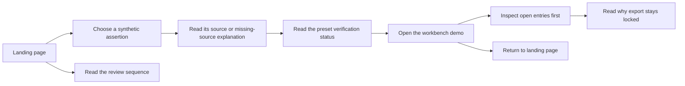

# Landing and demo flow

Scope: `/` introduces the product; `/workbench` preserves the synthetic ledger demonstration.

## Visitor outcome

A legal reviewer can understand the assertion/source/decision relationship, distinguish a demo from a live service, and inspect a sample matter.

## Interaction contract

- Primary action opens `/workbench`; the page accepts no uploads and makes no model calls.
- Liability, termination and governing-law buttons select existing synthetic fixtures. Pressed state and a polite announcement identify the selected example. They do not perform verification.
- A verified sample assertion does not unlock the matter: other open entries still block it.
- All statuses carry text and a distinct icon. Unsupported examples show a missing-source explanation rather than an empty quote area.
- Keyboard users enter through the skip link, choose examples using native buttons and inspect the focusable locked export control.
- System light/dark preferences apply across the page. Reduced motion disables Lenis and entrance animation, preserving content and selection feedback.
- The workbench has a Home link. There are no pretend registration, contact, pricing or submission controls.

## Acceptance evidence

Web tests cover the demo route, contradictory/missing-source selection, reduced-motion static content, retained ledger ordering/export explanation and Lenis lifecycle cleanup. Browser evidence is recorded in the role handoff; it must be refreshed after a material UI change.
