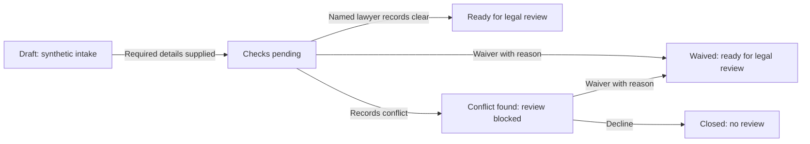

# Matter intake and conflict-check walkthrough

Surface: `/workbench/intake`. Mode: Operate, inside the existing workbench design system.

This is an in-memory synthetic interaction prototype. It demonstrates proposed states and visibility; it does not open a real matter, search a register, authenticate a person, retain an audit record or begin legal review. Enter invented examples only. Reloading or Start again resets the sample.

The prototype's reviewer identity and timestamps are fixed invented fixtures. A waiver needs a nonblank reason, at most 2,000 Unicode code points after trimming; this mirrors the service validation boundary and does not establish legal sufficiency. The simulated record displays who found and waived a conflict, including a same-lawyer flag, and explains future sign-off visibility. It does not impose separation of duties.

Lawyer mode exposes synthetic register matches, result choices and the simulated record. Requester mode shows coarse status, lawyer and target date. Pending and conflict share the same requester status; cleared and waived share a status; declined shows Closed without a reason. Privileged fixture text and waiver reasons are removed from requester DOM and announcements.

The view selector is a demonstration control, not an access control. Synthetic fixtures remain bundled client-side. Actual requester protection must be enforced by tenant/matter authorization and safe server projections before real data is connected.

Native radio groups use arrow keys. Validation focuses the first invalid field and links inline recovery text. Recording a result focuses its explanatory heading; Start again returns focus to the first editable field. Status changes have polite live announcements. Explicit text and different icon shapes accompany each status colour.

The shared Lenis provider and GSAP ticker remain the only smooth-scroll instance. A scoped `useGSAP` result transition lasts 200 ms, uses cleanup and is disabled under reduced motion. Work surfaces have no entrance sequence. Existing tokens, typography, native controls and responsive single-column composition are preserved.

No form submission, file picker, upload, network mutation, model call or storage API is introduced. Browser verification must observe requests and storage as well as visually check both themes, narrow layouts, keyboard operation and reduced motion. Source CI and recorded Scrum Master/QA review are still required before merge; a walkthrough is not completed persisted intake or product acceptance.
