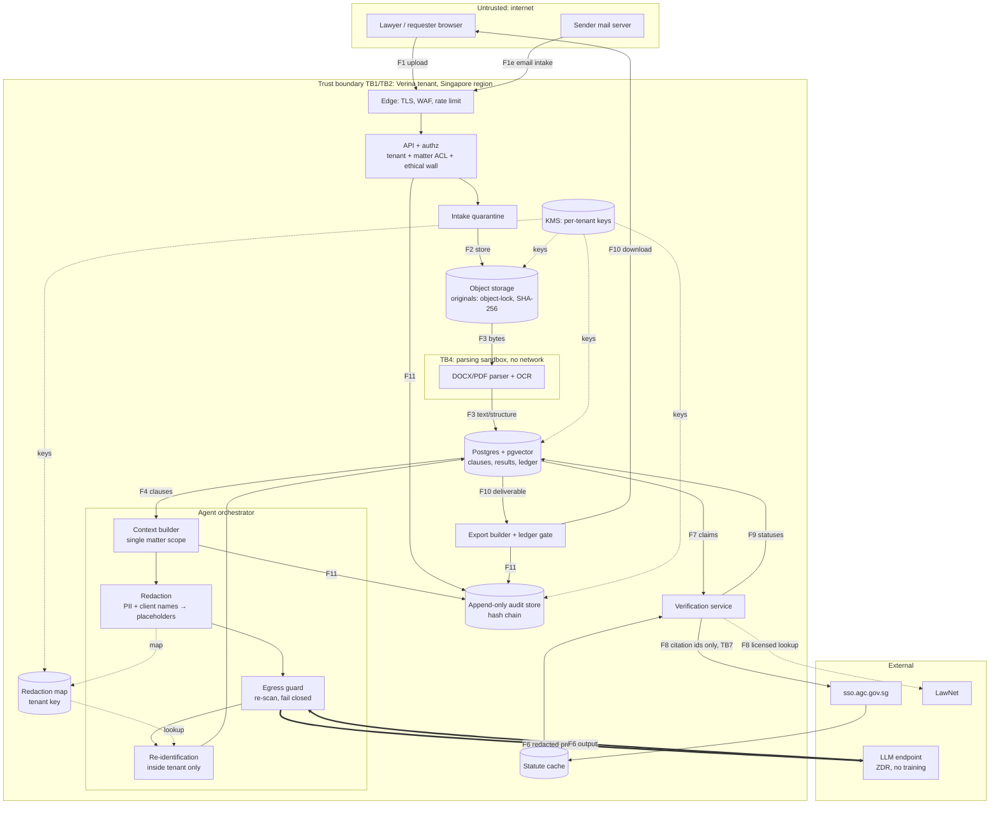

# Verina data flows (v0)

| | |
| --- | --- |
| Version | v0 (Sprint 0, task T0.3 / EN-4) |
| Owners | verina-security (flows, boundaries, encryption) · verina-pdpa-counsel (PDPA overlay, §8) |
| Status | Draft, design-time. No code exists yet, so every row below is a **planned** flow, not an observed one. |
| Related | [THREAT_MODEL.md](THREAT_MODEL.md) · [CONTROLS.md](CONTROLS.md) · [`docs/compliance/DATA_INVENTORY.md`](../compliance/DATA_INVENTORY.md) |

## 1. Classification scheme

| Class | Definition | Examples | Handling minimum |
| --- | --- | --- | --- |
| **Public** | Published by an authoritative source; integrity matters, confidentiality does not | SSO statute text, published judgments | Integrity hash + source/version metadata |
| **Internal** | Verina operational data with no client content | Service metrics, feature flags, prompt template ids | Access-controlled; no client content |
| **Confidential** | Tenant data that is not itself privileged content or personal data | Playbooks, tenant config, user directory, audit metadata, statute cache entries tied to a matter | Tenant-scoped access, encryption at rest, audit on admin change |
| **Privileged+Personal** | Client documents, lawyer work product, and any data identifying an individual | Originals, OCR text, parsed clauses, review results, memos, redlines, prompts/outputs carrying matter content, redaction map | Matter ACL + ethical walls, tenant key encryption, never leaves the tenant except the redacted model payload (F6), every access audited |

When a flow mixes classes, it takes the highest class present.

## 2. Diagram

The **only** flow that sends matter content out of the tenant is **F6**, and it passes through redaction (RED) and the egress guard (GUARD) first.

## 3. Numbered flows

| # | Flow | From → To | Data | Class | Boundary crossed | In transit | At rest |
| --- | --- | --- | --- | --- | --- | --- | --- |
| F1 | Web intake | Browser → API | Matter metadata (counterparty, type, value, deadline), files | Privileged+Personal | TB1 | TLS 1.2+ (1.3 preferred), HSTS | — |
| F1e | Email intake | Sender MTA → intake service → quarantine | Email headers, body, attachments | Privileged+Personal | TB1 | SMTP with STARTTLS (opportunistic; cannot be guaranteed from the sender side) | Quarantine store encrypted (tenant key) |
| F2 | Store original | API → object storage | Original file, SHA-256, uploader, time | Privileged+Personal | Internal | TLS within VPC | AES-256, per-tenant data key, object lock (immutable original) |
| F3 | Parse / OCR | Object storage → sandbox → DB | Text, clause tree, definitions, cross-refs, tracked changes, comments, hidden-text flags | Privileged+Personal | TB4 (into sandbox) | Local / TLS | DB encrypted at rest; tenant key for content columns |
| F4 | Context build | DB → orchestrator | Clauses for one matter, playbook rules (version id) | Privileged+Personal (clauses), Confidential (playbook) | TB3 enforced (single matter) | TLS within VPC | In memory only |
| F5 | Redact | Orchestrator → redaction → map | Personal data and client identifiers replaced by typed placeholders; map stored | Privileged+Personal | — | In process | Map encrypted with tenant key; never logged in plaintext |
| **F6** | **Model call** | **Egress guard → LLM endpoint → egress guard** | **Redacted prompt (instructions + delimited document excerpts + playbook rules); model output** | **Confidential after redaction (residual risk: contract terms remain)** | **TB6 — leaves tenant** | TLS 1.2+ to allow-listed host via egress proxy | Provider: zero data retention + no training (contract, NFR-1). Verina: prompt/output stored in audit store, encrypted |
| F7 | Re-identify + store results | Orchestrator → DB | Review scores, evidence quotes, draft text, extracted claims | Privileged+Personal | — | TLS within VPC | Encrypted at rest |
| F8 | Authority lookup | Verification → SSO / LawNet → statute cache | Outbound: statute/section identifiers or citation strings only. Inbound: public text | Public (outbound must not contain matter text) | TB7 — leaves tenant (identifiers only) | TLS | Cache with URL, version date, fetched-at, content hash |
| F9 | Ledger update | Verification → DB | Entry status, source link, quote-match result, attestation (name, time, reason, exact text) | Confidential / Privileged | — | TLS within VPC | Encrypted at rest |
| F10 | Export | DB → export builder (gate) → browser | Redline DOCX, memo, client summary, AI-use disclosure | Privileged+Personal | TB1 (outbound to user) | TLS; short-lived signed download URL | Export artefact retained per matter retention |
| F11 | Audit | All services → audit store | Event, actor, matter, model id/version, template id/hash, source ids, prompt/output (encrypted), hashes | Privileged+Personal by reference | TB9 (append-only) | TLS within VPC | Append-only, hash-chained, tenant key, chain head anchored to WORM storage |
| F12 | Audit pack export | Audit store → browser | Matter audit pack (PDF + JSON) with integrity proof | Privileged+Personal | TB1 | TLS | As F10 |
| F13 | Identity | Browser ↔ customer IdP ↔ API | Assertions/tokens, user identifiers, group claims | Confidential + Personal | TB1, TB8 | TLS | Session store encrypted; no IdP secrets in DB plaintext |
| F14 | M365 / DocuSign (later sprints) | API ↔ customer SaaS | Files the user selects; OAuth tokens | Privileged+Personal | TB8 | TLS | Tokens encrypted with tenant key |
| F15 | Operational telemetry | Services → monitoring | Metrics, traces, logs **without document text or prompts** | Internal | Possibly leaves tenant if SaaS monitoring is chosen | TLS | Field allow-list; PII scrubber |

## 4. Redaction point (F5 → F6)

1. Redaction happens **inside the orchestrator**, after the context is assembled and **before** any byte is handed to the model client. No other module may call a model (CI rule: model SDK imports outside `apps/api/verina/ai/orchestrator` fail the build).
2. The egress guard runs a second, independent PII detector over the **final serialised request** (system prompt, messages, tool results). Any detection above threshold **blocks the call** and raises an audit event (fail closed). This is the enforcement point for the AGENTS.md blocking rule "unredacted personal data to an external model".
3. Every call records: redaction rule-set version, placeholder counts by type, guard result, model id/version, template id + hash, matter id, and source ids (NFR-7).
4. The redaction map never leaves the tenant and is never included in prompts, logs or telemetry. Re-identification happens only when rendering results for an authorised user.
5. Residual risk: redaction removes identifiers, not commercial confidentiality. Contract terms still reach the provider under ZDR. The firm AI policy (FR-9.3) must state this, and the AI-use disclosure (FR-9.1) must describe it in plain English.
6. Redaction rules (what counts as personal data, client names, placeholder types) are specified by verina-pdpa-counsel; see the PDPA overlay (§8).

## 5. What leaves the tenant (egress inventory)

Prepared with the `lq-local-first-legal-workspace` method, adapted from "what leaves the machine" to "what leaves the tenant". **Access mode: user-supplied architecture (design docs only, no code, no runtime capture).** Row evidence state is therefore `planned` or `unknown`; nothing here is `observed`.

### 5.1 Tenant state map

| Data type | Location | Sensitivity | Deletion method | Backup implication |
| --- | --- | --- | --- | --- |
| Original documents | Object storage (SG), object-locked | Privileged+Personal | Matter deletion after retention period; object lock period must not exceed retention commitment | In provider snapshots/versioning ≤ 35 days (NFR-5) |
| Parsed text, clauses, embeddings | Postgres + pgvector (SG) | Privileged+Personal | Matter deletion cascades | DB backups ≤ 35 days |
| Review results, drafts, ledger | Postgres (SG) | Privileged+Personal | Matter deletion | DB backups ≤ 35 days |
| Redaction map | Postgres (SG), tenant-key encrypted | Privileged+Personal (highest) | Matter deletion; crypto-shred with key | DB backups ≤ 35 days |
| Audit log incl. prompts/outputs | Append-only store (SG) | Privileged+Personal by reference | Retention-based; hash chain must support redaction of payloads while keeping hashes (design S1) | WORM anchor |
| Workflow history | Temporal (location depends on hosting decision) | Ids only by design | Namespace retention | Depends on hosting |
| Application logs/telemetry | Monitoring stack | Internal (no content by design) | Log retention policy | Depends on vendor |

### 5.2 External calls

| Destination | Trigger | Payload | Credential | Retention | Opt-out | Evidence | Retrieval date | Status |
| --- | --- | --- | --- | --- | --- | --- | --- | --- |
| LLM endpoint (Anthropic API with ZDR, or Bedrock/Vertex in-region — PO decision S2) | Triage, review, drafting, claim extraction, verification assist | Redacted prompt (F6) | Verina service key per environment, in secret manager | ZDR + no training required by NFR-1; **contract not yet in place** | Firm AI policy can disable AI features per tenant | Architecture section of product spec; NFR-1 | — | planned / unknown until S2 review |
| Singapore Statutes Online | Ledger statute check | Act + section identifiers | None | Public site | Ledger check can fall back to manual verification | FR-6.1 | — | planned |
| LawNet | Case verification (if licensed) | Citation strings | Firm or Verina licence credential | Per licence | Optional; lawyer-linked source alternative | FR-6.2; PO decision S4 | — | unknown |
| Lawyer-linked judgment hosts | Lawyer links a judgment URL | GET of the URL (no matter content) | None | Public | Upload file instead | FR-6.2 | — | planned (allow-list required) |
| Customer IdP | Login | Auth request / assertion | Per-tenant IdP config | Customer's | — | Architecture | — | planned |
| M365 / DocuSign | User-initiated file pick / envelope (later) | User-selected files, tokens | Per-user OAuth | Customer's tenant | Feature optional | Architecture; non-goal: e-signature in MVP | — | planned (later) |
| Email (inbound only) | Sender forwards matter | Email + attachments (inbound) | Intake token | — | Web intake alternative | FR-1.1 | — | planned |
| Monitoring / error reporting vendor | Errors, metrics | Must exclude content | Vendor key | Vendor's | — | — | — | unknown (vendor not chosen) |
| OCR service | — | **Not permitted** to be external; local OCR assumed | — | — | — | Threat model §9 | — | design constraint |
| Fonts, CDNs, analytics on authenticated pages | — | **Not permitted** (self-host all assets) | — | — | — | Threat model WEB-4 | — | design constraint |
| Temporal Cloud (if chosen) | Workflow execution | Ids + encrypted payloads | Namespace cert | Vendor's | Self-host alternative | Threat model §9 | — | unknown |

### 5.3 Credential handling (planned)

- All service credentials (model keys, DB, KMS, IdP client secrets, LawNet, OAuth client secrets) live in the cloud secret manager, fetched at runtime, scoped per environment, rotated on a schedule and on staff change.
- Per-user OAuth tokens (M365/DocuSign) encrypted with the tenant data key.
- No credentials in the repository (`.env.example` only; pre-commit + gitleaks).
- Development uses fake model clients by default; a real key, when needed, is a developer-scoped key with no production data.

### 5.4 Disclosure note (draft, for firms and their clients)

> Verina stores your documents, review results and audit records in Singapore, encrypted with keys specific to your firm. When an AI feature runs, Verina sends the relevant excerpts of the contract, with personal data and client names replaced by placeholders, to the AI model provider named in your firm's AI policy. The provider is contracted not to keep or train on that content. Statute and case checks send only the citation, never your documents. Contract terms themselves are not anonymised and do reach the model provider. Verina never sends anything to your client or counterparty by itself.
>
> **Confidence: Low.** This note describes the design. It has not been verified against code, configuration, network capture or a signed provider agreement. It must not be given to clients until those are reviewed (target: before pilot, S8).

### 5.5 Unknowns and verification needed

| Item | Needed by | Owner |
| --- | --- | --- |
| Model route and signed ZDR/no-training terms, processing region | S2 | SEC + PDPA → PO |
| Cloud provider and region (ADR-002) | S1 | ENG → PO |
| Temporal hosting model | S1 | ENG + SEC |
| OCR engine (must be local) | S2 | ENG |
| Monitoring/error-reporting vendor and its data scrubbing | S1 | ENG + SEC |
| Runtime egress capture (proxy logs) proving only allow-listed hosts are contacted | S8 (pen test), continuous after | SEC + QA |
| LawNet licence terms | S4 | PO |

## 6. Encryption summary

| Layer | Control |
| --- | --- |
| In transit, external | TLS 1.2+ (prefer 1.3), HSTS with preload, modern cipher suites only |
| In transit, internal | TLS/mTLS between services; DB connections require TLS |
| At rest | AES-256 provider encryption for all stores; per-tenant data keys (envelope encryption via KMS) for content; customer-managed key option (NFR-3) |
| Field level | Redaction map, OAuth tokens, prompts/outputs in audit store encrypted with tenant key |
| Key management | KMS in SG region; key rotation yearly and on incident; crypto-shredding for tenant offboarding |

## 7. Flow invariants (testable)

1. No outbound connection from any workload except the egress proxy; the proxy allow-list contains only the hosts in §5.2.
2. F6 payloads contain no detector hits above threshold (guard log = 100% of calls).
3. F8 payloads contain only identifier patterns (regex-validated).
4. Every F6 call has a matching F11 audit event with model id/version and template hash.
5. No matter content appears in F15 (telemetry) — scrubber tests with canary strings.
6. A user without matter access receives no F4/F7/F10 data for that matter, including search hits and AI context (NFR-4).

## 8. PDPA overlay — to be completed by verina-pdpa-counsel

> **Owner: verina-pdpa-counsel.** This section is intentionally left for PDPA counsel. It should be completed from, and kept consistent with, [`docs/compliance/DATA_INVENTORY.md`](../compliance/DATA_INVENTORY.md) (being written in parallel, task T0.4).

Requested content, per flow F1–F15:

- Categories of personal data and data subjects (clients, counterparties, employees named in contracts, users).
- Purpose and PDPA basis for collection, use and disclosure; Verina's role (data intermediary vs organisation) per flow.
- Transfer Limitation Obligation assessment for F6 if any processing occurs outside Singapore, and for any vendor in §5.2.
- Retention period and deletion trigger per data type (aligns with §5.1 and NFR-5).
- Redaction rule-set: what is redacted at F5, placeholder taxonomy, and accepted residual risk.
- Breach notification triggers relevant to each flow.

Completed by verina-pdpa-counsel, 2026-10-13 (v0). This is a summary; the detail is in [`DATA_INVENTORY.md`](../compliance/DATA_INVENTORY.md) (D-/V- ids), [`PDPA_ASSESSMENT.md`](../compliance/PDPA_ASSESSMENT.md) and the redaction rule-set in [`PII_TAXONOMY.md`](../compliance/PII_TAXONOMY.md) / [`pii-taxonomy.json`](../compliance/pii-taxonomy.json). "DI" = Verina is a data intermediary (PDPA s 4(2)): it must comply with ss 24 and 25 and notify the customer of breaches (s 26C(3)(a)), and the customer has every other obligation. "ORG" = Verina is the organisation.

| Flow | Personal data categories (highest tier) | Purpose / basis | Role | Cross-border? | Retention | Breach-notification relevance / notes |
| --- | --- | --- | --- | --- | --- | --- |
| F1 | Everyone named in uploaded contracts; requester (T1 possible: NRIC, bank details, signatures) | Customer-instructed review; customer's basis (consent / deemed consent / exception) | DI | No (SG) | D-01, D-03: matter closure + 12 months (proposed, Q-6) | Upload of the wrong file to the wrong matter is a disclosure within the customer org (s 26B(4)); cross-tenant exposure is a reportable DI breach to the customer |
| F1e | Senders, recipients, people in body/attachments (T1) | Matter creation from email | DI | Inbound MTA region **TBD** | D-02: 30 days if not converted (Q-11) | Mis-routed or spoofed email exposure → DI notice to customer |
| F2 | As F1 (T1) | Store original unchanged (FR-2.1) | DI | No | D-01 | Object-lock period must not exceed the retention commitment (s 25) |
| F3 | As F1 + tracked-change authors (T1) | Parse/OCR for review | DI | No; OCR must be local | D-04 cascade with matter | Sandbox escape = s 24 failure |
| F4 | Clauses for one matter (T1) | Build AI context | DI | No | In memory | Cross-matter context = disclosure + ethical-wall breach |
| F5 | All detected identifiers → **redaction map** (T1, highest concentration) | Protection control (s 24); confidentiality (PCR r 6) | DI | No | D-05: deleted with matter (crypto-shred) | Map compromise defeats redaction: treat as T1 breach of everything in the matter |
| **F6** | Pseudonymised excerpts + outputs (still personal data; residual context) | Inference on customer instruction | DI; provider = sub-processor (GenAI AG para 7.4) | **TBD (S2).** If outside SG: PDP Regs reg 11 contract naming countries, or reg 12 certification, + per-matter disclosure. Not "data in transit" | Provider: ZDR required. Verina copy: D-09 | Provider must notify Verina ≤24h (DPA checklist #10). Unredacted T1/T2 reaching the provider = incident, assess with customer |
| F7 | Re-identified results (T1) | Deliverables | DI | No | D-07 | Re-identification error = inaccurate attribution + unauthorised disclosure (s 23 for the customer; s 24) |
| F8 | None outbound (identifiers only); inbound public judgments (T3, publicly available) | Verification | DI (cache) | Outbound to SG sites; judgment hosts may be overseas (GET only, no personal data sent) | D-12 | Outbound matter text would be an egress breach (invariant §7.3) |
| F9 | Attesting lawyer name/time/reason; assertions (T3–T1) | Verification Ledger | DI | No | D-08 | — |
| F10 | Deliverables (T1) | Delivery to the user | DI | Leaves to the user's device (customer's control) | D-07; export link short-lived | Wrong-recipient download link = DI breach |
| F11 | Actor ids; encrypted payload copies (T1 by reference) | Accountability (FR-9.2) | DI (matter events); ORG (Verina security events) | No | D-09: matter + 12 months; payload crypto-shred, hashes kept | Audit store holds prompts: protect as T1 |
| F12 | As F11 | Audit pack to the customer | DI | Leaves to the user's device | D-10: server copy 7 days | Privileged & Confidential labelling (PDPA_ASSESSMENT §4) |
| F13 | User identity, IP, session (T3) | Access control | DI (tenant directory D-13); ORG (security logs V-02) | IdP is the customer's | D-13; V-02 12 months | Account takeover → assess both roles |
| F14 | User OAuth tokens (T1 credential); selected files (T1) | Integrations (later) | DI | Customer's own M365/DocuSign tenancy | D-14 until revoked | Token theft = DBN reg 3(1)(b) style credential breach |
| F15 | None intended (user ids possible) | Reliability | ORG | Vendor **TBD**: region review (C-2.3) | V-03 30–90 days | Content in telemetry = protection failure; canary tests |

## 9. Change log

| Version | Date | Change | Author |
| --- | --- | --- | --- |
| v0 | 2026-10-13 | Initial flows, egress inventory, redaction point | verina-security |
| v0.1 | 2026-10-13 | §8 PDPA overlay completed | verina-pdpa-counsel |
