# Delivery plan

Owner: QA with engineering and security · 2026-10-13 · Proposed; no deployment workflow exists.

## Current evidence boundary

`.github/workflows/ci.yml` checks the source tree and builds the web application. It does not package a deployable API/web release, provision infrastructure, deploy to staging or production, or perform rollback. A successful local build is evidence about that workspace only. Hosted check results and repository protection settings must be verified on the selected Git repository.

## Separate decisions

| Term | Required evidence | Accountable role |
| --- | --- | --- |
| Done Increment | Acceptance behaviour, integrated code, required reviews and the team's [Definition of Done](../process/DEFINITION_OF_DONE.md) met | Developers, with QA evidence review |
| Deployment | A specific version installed in a named environment; health checks and rollback recorded | Engineering/operations |
| Product release | Accountable owner permits users to use a defined capability after applicable release gates | Product owner |

A Sprint Review inspects outcomes and adapts the backlog. It does not replace the quality standard or a production release decision. A Done Increment can be reviewed before production deployment; unfinished work remains identified as unfinished.

## Proposed pipeline

```mermaid
flowchart LR
    A[Feature commit] --> B[Source checks and review]
    B --> C[Build immutable release artifact]
    C --> D[Artifact smoke tests and dependency inventory]
    D --> E[Deploy same artifact to staging]
    E --> F[Staging journey and migration checks]
    F --> G[Production release decision]
    G --> H[Promote same artifact to production]
    H --> I[Health and smoke checks]
    I --> J[Monitor or rollback]
```

This is a plan, not the current implementation. Engineering must select the packaging and hosting approach before adding deploy jobs. Security and PDPA review applies to the selected data flows and environments. No live client data or external model transport is enabled by this plan.

## Work sequence and completion evidence

| Work | Owner | Dependency | Completion evidence |
| --- | --- | --- | --- |
| Confirm hosted CI job names and protect main | Repository admin + QA | Selected remote and first workflow run | Run URL, exact required check names, protection settings |
| Add real persistence integration checks | Engineering + QA | Reviewed database design | Migration and constraint checks against chosen database; synthetic isolated fixtures |
| Add critical browser journeys | UI + QA | Usable application flow | Keyboard/reduced-motion and automated accessibility evidence, application-level outcomes |
| Choose release format and create artifact inventory | Engineering + security | Hosting/package decision | Artifact digest, source commit, dependency versions and SBOM |
| Add staging deployment and smoke tests | Engineering + QA | Reviewed infrastructure and artifact | Deployed digest matches build; migrations, health and critical journey results |
| Rehearse production promotion and rollback | Engineering + security + PO | Staging checks and release controls | Scoped environment credentials, reviewer configuration, restored previous version and data compatibility |

Each deployment record must contain the commit, artifact digest, configuration version, environment, approver where required, smoke-test results and rollback destination. Test the package actually installed; rebuilding a different artifact after staging invalidates the promotion evidence.

## Release blocks

- Open Critical/High security findings remain release-blocking under the team charter, including development-tool findings unless the PO records a decision. Informational CI audit output is visibility, not risk acceptance.
- Skipped local scanners, absent hosted CI, missing legal review and missing deployment checks remain visible gaps; a source-check pass cannot close them.
- Production model access requires the reviewed provider, redaction and audit controls. Default tests retain local fakes and explicit mock transports.
- A rollback that restores code but breaks stored data is inadequate. Migration reversibility or forward recovery must be exercised before release.

## Measurements

Record hosted pipeline duration, failure causes, flaky tests and recovery time at each review. The under-ten-minute CI target is a target until measured. Improve the slowest steps while retaining checks that protect the acceptance behaviour and security boundaries.
